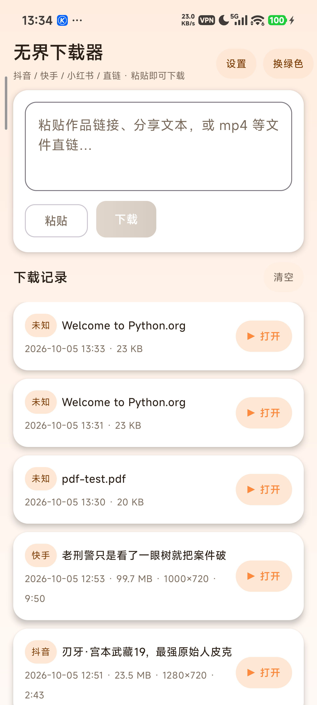
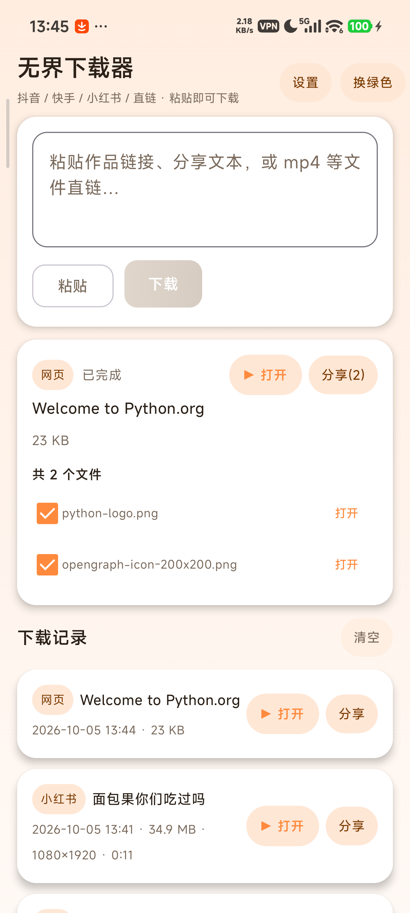
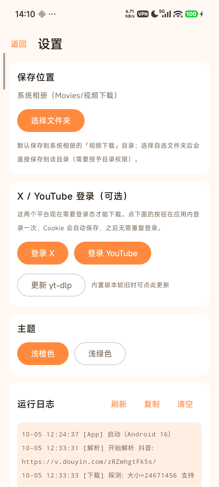

<div align="center">

# 秒存

**粘贴链接，即刻下载**

macOS / Windows / Android 三端同款的本地素材备份工具 · 开源核心版

MiaoCun — paste a link, save it locally. A cross-platform media backup tool.

[📥 下载完整版](https://music.aiyun-jing.com:8443/download/) ·
[🌐 官网](https://music.aiyun-jing.com:8443/download/) ·
[📦 发布记录](https://github.com/WangChangDian/miaocun-releases) ·
[📄 MIT License](LICENSE)

</div>

---

「收藏」不等于「拥有」——平台上的内容随时可能消失，画质也说变就变。
秒存做的事情很简单：**把你要用的东西，从平台搬进自己的设备**。

<div align="center">



</div>

## 核心能力

- **三端同款** —— Mac（SwiftUI 原生）、Windows（Tauri）、Android（Kotlin + Compose）同一套界面与交互；
- **装完即用** —— 官方发布版内置运行环境，不需要预装 Python / ffmpeg；
- **多线程分段下载** —— 最多 8 段并发 + 断点续传 + 多 CDN 重试，大文件也能跑满带宽；
- **通用解析** —— 基于 yt-dlp：YouTube（4K 自动合并音视频）、X、B 站、微博、TikTok、
  Reddit、Vimeo、Twitch、网易云、QQ 音乐…… 上千个站点开箱即用；
- **任意文件直链** —— PDF / 压缩包 / 文档 / 音频视频，粘进来就是一次下载任务；
- **网页资源嗅探** —— 普通网页里的图片与视频会自动识别，多文件可勾选批量保存；
- **顺手的管理** —— 下载记录、缩略图预览、一键打开、多选分享、主题切换（浅橙 / 浅绿）；
- **登录态自管** —— Cookie 默认只存本机；登录后可加密同步，手机端 / 电脑端互换（可一键清空）。

## 开源范围（请先读这一段）

本仓库是**开源核心版**，与官网发布的完整版功能有差异：

| | 开源核心版（本仓库） | 完整版（官网发布） |
| --- | --- | --- |
| 三端客户端完整源码 | ✅ | ✅（同源） |
| 引擎框架（协议 / 下载管理 / 通用解析 / 嗅探） | ✅ | ✅ |
| 国内平台适配层（抖音 / 快手 / 小红书 / 视频号等） | ❌ 占位实现 | ✅ |
| 云控后台与部署配置 | ❌ 不公开 | ✅ |

> 国内平台的适配层涉及平台接口细节与合规边界，不在开源范围内；
> 开源版调用到这些平台时会给出明确提示（而不是静默失败）。
> 欢迎社区按 `engine/README.md` 的接口约定贡献自己的实现。

## 架构

```
SwiftUI 外壳 (app/)          Tauri 外壳 (tauri/)          Android (android/)
        └──────────────┬──────────────┘                        │
                Python 引擎 (engine/)                     WebView + 内嵌运行时
        bridge.py · JSON Lines 协议 · 平台适配层             (Kotlin + Compose)
                        │
                 系统相册 / 下载目录
```

- **引擎**是常驻进程，通过 stdin / stdout 收发单行 JSON：外壳只负责界面与交互，
  解析、下载、进度、文件管理全部在引擎里完成（协议详见 [`engine/README.md`](engine/README.md)）；
- **同一套引擎服务三个端**，因此三端的下载行为完全一致；
- 平台适配层在 `engine/bridge.py` 里以函数形式组织（开源版为占位实现，见上文说明）。

## 快速开始

### 引擎（三端共用）

```bash
# 需要 Python 3.13
python3.13 engine/bridge.py        # 然后往 stdin 打一行 JSON，例如：
# {"id":"1","cmd":"ping"}
# {"id":"2","cmd":"download","url":"https://example.com/a.pdf","out_dir":"~/Downloads"}
```

### macOS

```bash
bash scripts/build-app.sh --zip    # 产出 dist/秒存-macOS-<版本>.zip
# 未内置运行时前，引擎依赖会安装到应用数据目录的 venv（见 scripts/bootstrap-engine.py）
```

### Android

```bash
bash scripts/build-android.sh      # 产出 dist/秒存-Android-<版本>.apk
```

### Windows（Tauri）

```powershell
cd tauri
npm install
npm run tauri build                # 或使用 scripts\build-windows.ps1
```

> 详细开发说明（环境、协议、目录、调试）见 [`docs/DEVELOPMENT.md`](docs/DEVELOPMENT.md)。

## 常见问题

**Q：为什么抖音 / 快手 / 小红书链接提示「未包含在开源版」？**
这类平台的适配层不在开源范围。官网下载的完整版支持；也可以按 `engine/README.md`
的约定自己实现后补回 `engine/bridge.py`。

**Q：自己编译的版本和官网版本能共存吗？**
可以。两个版本共用同一个应用数据目录（`~/Library/Application Support/视频下载器`，
Windows / Android 类似），互不影响；但自编译的安装包签名不同，无法覆盖安装官方包。

**Q：数据与隐私怎么处理？**
下载记录、设置、平台登录态默认只存本机；不收集通讯录、短信、相册、位置。
详见官网的[隐私政策](https://music.aiyun-jing.com:8443/download/privacy.html)。

## 第三方组件

本项目使用了多个优秀的开源项目（yt-dlp、ffmpeg、Playwright / Chromium、Kotlin / SwiftUI 生态等）。
完整清单、版本与许可证见 [`legal/THIRD-PARTY-NOTICES.txt`](legal/THIRD-PARTY-NOTICES.txt)。
其中 GPL 组件以「运行时获取」方式使用，不随本仓库分发。

## License

[MIT](LICENSE) · 本工具仅供个人学习与素材备份使用；请遵守各平台服务条款，
不用于下载付费 / 会员内容，不用于批量爬取。
