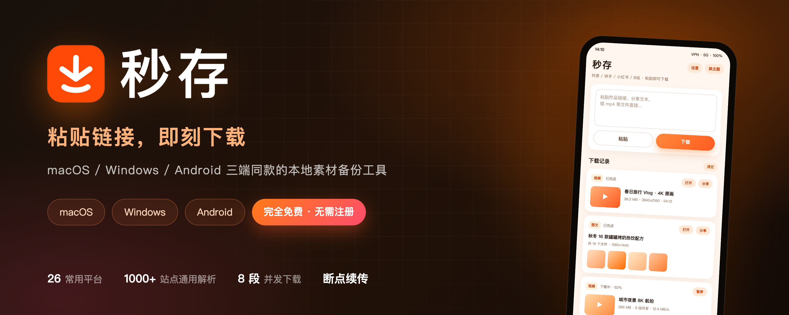
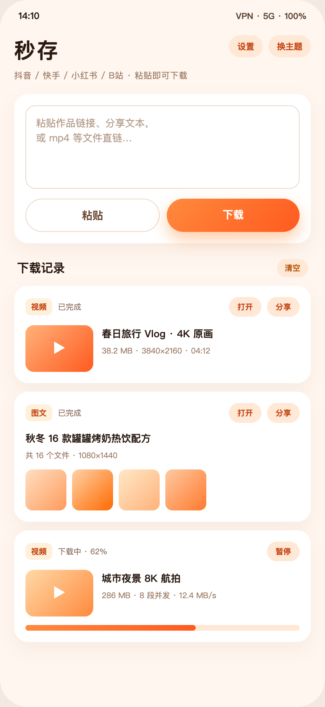
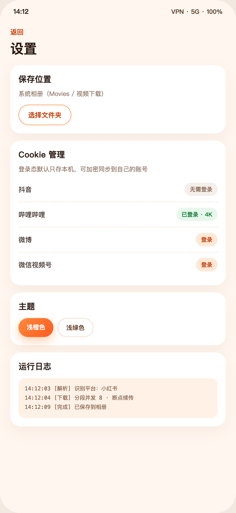
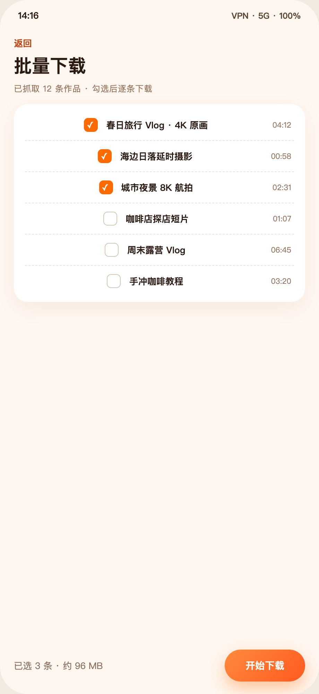

<div align="center">



<br />

**粘贴链接，即刻下载。**

macOS · Windows · Android 三端同款的本地素材备份工具

<sub>MiaoCun — paste a link, save it locally. A cross-platform media backup tool with an open-source core.</sub>

<br />

[](LICENSE)
[](#快速开始)
[](#)
[](engine/README.md)

[⬇️ 下载](https://music.aiyun-jing.com:8443/download/) ·
[📦 发布记录](https://github.com/WangChangDian/miaocun-releases) ·
[🐛 问题反馈](https://github.com/WangChangDian/miaocun/issues)

</div>

---

## 收藏不等于拥有

刷到一段想留住的视频、一篇长文里的素材、一组想收藏的图片——**截图会糊，收藏会失效，录屏会掉帧**。

秒存只做一件事：**把你要用的内容，从平台搬进你自己的设备**。

- 不用打开浏览器装扩展，不用研究命令行参数；
- 不用折腾 Python / ffmpeg 环境——**装完即用**；
- 不用在手机和电脑之间倒腾文件——**三端同一套体验**。

## 它能做什么

| 能力 | 说明 |
| --- | --- |
| 🔗 **粘贴即下载** | 作品链接、分享口令、短链、mp4 / PDF 等直链，粘进输入框就开工 |
| ⚡ **多线程分段下载** | 最多 **8 段并发**（类 IDM）+ 断点续传 + 多 CDN 重试，大文件跑满带宽 |
| 🧲 **上千站点通用解析** | 基于 yt-dlp：YouTube（4K 自动合并）、X、B 站、微博、Reddit、Vimeo、Twitch、网易云… |
| 🕵️ **网页资源嗅探** | 普通网页里的图片 / 视频自动识别，多文件勾选批量保存 |
| 🗂 **下载管理** | 缩略图预览、下载记录、一键打开、多选分享、批量归档 |
| 🎨 **细节讲究** | 浅橙 / 浅绿双主题、文件名模板、自定义保存目录、代理设置 |

## 界面预览

<div align="center">



<br />
<sub>界面示意 —— 实际界面以发布版为准</sub>
</div>

## 为什么是"三端同款"

大多数下载工具只做单端：手机上存不了、电脑上又装不了，素材照样散落。
秒存的三个外壳共享**同一套 Python 引擎**——解析、下载、进度、文件管理的行为完全一致，
换设备没有学习成本。

```
SwiftUI 外壳 (app/)          Tauri 外壳 (tauri/)          Android (android/)
        └──────────────┬──────────────┘                        │
                Python 引擎 (engine/)                     Kotlin + Compose + WebView
        bridge.py · JSON Lines 协议 · 平台适配层
                        │
                 系统相册 / 下载目录
```

- **引擎**是常驻进程：stdin / stdout 收发单行 JSON，外壳只负责界面与交互
  （协议详见 [`engine/README.md`](engine/README.md)）；
- 桌面端内置完整运行时（Python + ffmpeg + 浏览器内核），用户侧零安装；
- 安卓端内置 yt-dlp + QuickJS + ffmpeg，首次启动初始化约 20–30 秒。

## 和常见方案对比

| | 在线解析网站 | 命令行 yt-dlp | 单端下载 App | **秒存** |
| --- | :---: | :---: | :---: | :---: |
| 链接是否经过第三方服务器 | ❌ 上传到别人网站 | ✅ 本地 | 视产品而定 | ✅ **本地解析** |
| 画质 | 常被二次压缩 | 原始 | 参差不齐 | **原始 / 最高码率** |
| 批量能力 | 多为付费 | 自己写脚本 | 少见 | **勾选即下** |
| 三端同款 | ❌ | ❌（无 GUI） | ❌ | ✅ |
| 上手成本 | 低 | 高 | 低 | **低** |
| 登录态管理 | 无 | 手动导出 Cookie | 无 | **内置 + 加密云同步** |

## 快速开始

### 引擎（三端共用）

```bash
# 需要 Python 3.13
python3.13 engine/bridge.py

# 往 stdin 打一行 JSON 就是一次请求：
{"id":"1","cmd":"ping"}
{"id":"2","cmd":"download","url":"https://example.com/demo.mp4","out_dir":"~/Downloads"}
```

### macOS

```bash
bash scripts/build-app.sh --zip    # 产出 dist/秒存-macOS-<版本>.zip
```

### Android

```bash
bash scripts/build-android.sh      # 产出 dist/秒存-Android-<版本>.apk
```

### Windows（Tauri）

```powershell
cd tauri
npm install
npm run tauri build               # 或使用 scripts\build-windows.ps1
```

> 完整环境要求、调试方式与数据目录说明见 [`docs/DEVELOPMENT.md`](docs/DEVELOPMENT.md)。

## 目录结构

```
miaocun/
├── app/            # macOS 外壳（SwiftUI + SwiftPM）
├── android/        # Android 端（Kotlin + Jetpack Compose）
├── tauri/          # Windows / macOS 的 Tauri 外壳
├── engine/         # Python 引擎（bridge.py · JSON Lines 协议 · 平台适配层）
├── website/        # 官网静态页
├── legal/          # 第三方组件声明（THIRD-PARTY-NOTICES）
├── scripts/        # 构建 / 运行时打包脚本
└── docs/           # 开发文档与截图
```

## 常见问题

**Q：各平台的解析是怎么实现的？**
引擎对链接按「专用适配 → 通用解析」处理：常规站点统一走 yt-dlp 通用解析（覆盖上千个站点），
需要登录态或页面签名的入口会给出明确提示。扩展新平台按
[`engine/README.md`](engine/README.md) 的约定实现即可。

**Q：自己编译的安装包能覆盖官方版吗？**
不能。官方包与自编译包签名不同，需先卸载再安装；两者共用同一个应用数据目录
（`~/Library/Application Support/视频下载器`，Windows / Android 类似），数据不会丢。

**Q：需要登录吗？**
国内平台（抖音、快手、小红书）不需要；X / YouTube 需要登录自己的账号（平台风控要求），
登录态默认只存本机，可选加密同步到自己的账号。

**Q：我的数据会被上传吗？**
下载记录、设置、平台登录态默认只存本机；不收集通讯录、短信、相册、位置。
详见官网的[隐私政策](https://music.aiyun-jing.com:8443/download/privacy.html)。

**Q：为什么没有 iOS 版？**
App Store 对下载类工具限制严格，暂无计划。

## 第三方组件

本项目使用了众多优秀的开源项目（yt-dlp、ffmpeg、Playwright / Chromium、
Kotlin / Compose、SwiftUI 生态等）。完整清单、版本与许可证见
[`legal/THIRD-PARTY-NOTICES.txt`](legal/THIRD-PARTY-NOTICES.txt)。
其中 GPL 组件以「运行时获取」方式使用，不随本仓库分发。

## License 与免责声明

[MIT](LICENSE) © 2026 WangChangDian

本工具仅供个人学习与素材备份使用；请遵守各平台服务条款，
不用于下载付费 / 会员内容，不用于批量爬取。下载内容的版权归原作者所有。
